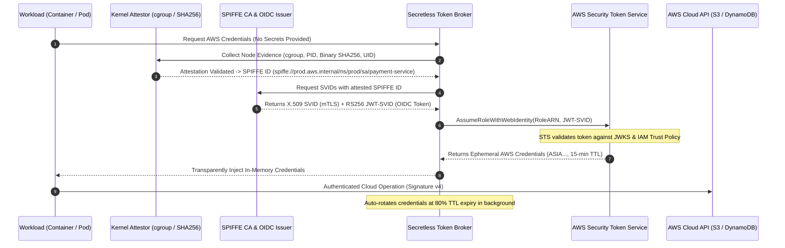

# Zero-Secret Workload Identity Federation Mesh

[](https://github.com/KoshaG0hil/Zero-Secret-Workload-Identity-Federation-Mesh/actions)
[](#threat-model)
[](https://spiffe.io/)
[](https://docs.aws.amazon.com/IAM/latest/UserGuide/id_roles_providers_oidc.html)
[](LICENSE)
[](https://www.python.org/)

An enterprise-grade, cryptographically verified **Zero-Secret Workload Identity Federation Mesh** implementing the **SPIFFE/SPIRE standard** and **AWS STS OpenID Connect (OIDC) Web Identity Federation**.

This engine eliminates static IAM access keys, API secrets, and long-lived credentials across cloud workloads. Ephemeral cryptographic identities (X.509 SVIDs and JWT-SVIDs) are minted through kernel and container attestation and exchanged directly with AWS STS (`sts:AssumeRoleWithWebIdentity`) for 15-minute temporary session tokens with automatic, zero-downtime rotation.

---

## 🏛️ Executive Architecture



---

## 🛡️ Threat Model: Eliminating the Secret Sprawl Attack Surface

| Traditional Cloud Risk | Impact | Zero-Secret Identity Mesh Solution |
| :--- | :--- | :--- |
| **Leaked IAM Access Keys** | Lateral movement, account takeover, ransom demand | **Zero static keys**: Workloads never receive static keys; only temporary STS session tokens. |
| **Hardcoded Secrets in Git** | Secret extraction by adversaries via commit history | **Zero secret storage**: No `.env`, secret managers, or config files stored on disk. |
| **Container Breakout / Impersonation** | Rogue container assuming adjacent container's role | **Kernel cgroup & binary digest attestation**: Identity is bound to cryptographic binary hash and UID. |
| **Replay & Token Stolen in Transit** | Replay of intercepted bearer tokens | **Cryptographic SAN URI & RS256 signatures**: Tokens expire in 15 minutes and require OIDC discovery validation. |
| **Privilege Escalation** | Assuming unauthorized cloud roles | **Strict IAM Condition Blocks**: AWS IAM Trust Policy strictly checks `StringEquals` on `${issuer}:sub`. |

---

## 🔑 Cryptographic & OIDC Specification

- **Root CA & X.509 SVID**: ECDSA (P-256) root with SAN URI extension `spiffe://prod.aws.internal/ns/{namespace}/sa/{service_account}`.
- **OIDC Discovery & JWKS**:
  - OpenID Provider configuration served at `/.well-known/openid-configuration`.
  - JSON Web Key Set (JWKS) exposing RS256 (2048-bit RSA) public modulus `n` and exponent `e`.
- **AWS STS Federation**:
  - Target call: `sts:AssumeRoleWithWebIdentity`.
  - Claims: `iss`, `sub`, `aud: sts.amazonaws.com`, `spiffe_id`, `exp` (900s TTL).

---

## 📂 Project Structure

```text
Zero-Secret-Workload-Identity-Federation-Mesh/
├── .github/
│   └── workflows/
│       └── ci.yml                   # Automated testing & security validation
├── src/
│   ├── __init__.py
│   └── mesh/
│       ├── __init__.py
│       ├── models.py                # SpiffeId, SVID, and Attestation data classes
│       ├── ca_authority.py          # SPIFFE X.509 Certificate Authority & SAN minting
│       ├── attestor.py              # Kernel cgroup, non-root, and binary digest attestor
│       ├── oidc_issuer.py           # OIDC Discovery, JWKS, & RS256 JWT-SVID signer
│       ├── sts_federator.py         # AWS STS AssumeRoleWithWebIdentity evaluation engine
│       └── secretless_broker.py     # In-memory client broker with auto-rotation
├── terraform/
│   ├── main.tf                      # IAM OIDC Provider & Role with SPIFFE trust policy
│   ├── variables.tf                 # Configurable trust domain and workload parameters
│   └── outputs.tf                   # Provider and Role ARNs
├── tests/
│   ├── conftest.py                  # Pytest path and harness configuration
│   └── test_mesh.py                 # 19 comprehensive unit & integration tests
├── cli.py                           # Command-line interface for testing & verification
├── requirements.txt                 # Cryptography, Boto3, Pytest
├── LICENSE                          # MIT License
└── README.md                        # Documentation & architecture guide
```

---

## 🚀 Quickstart & CLI Usage

### 1. Installation
```bash
git clone https://github.com/KoshaG0hil/Zero-Secret-Workload-Identity-Federation-Mesh.git
cd Zero-Secret-Workload-Identity-Federation-Mesh
pip install -r requirements.txt
```

### 2. Attest Workload & Mint SVIDs
```bash
python cli.py attest --name payment-service --namespace prod --service-account payment-service
```
*Output:*
```text
============================================================
 [Zero-Secret Mesh] Kernel & Workload Attestation
============================================================
[+] Attestation SUCCESS: Workload verified.
    SPIFFE ID      : spiffe://prod.aws.internal/ns/prod/sa/payment-service
    Trust Domain   : prod.aws.internal
    Namespace      : prod
    ServiceAccount : payment-service

[+] Issued X.509 SVID:
    Serial Number  : 2314918239102931209
    Valid From     : 2026-11-08T12:50:00+00:00
    Expires At     : 2026-11-08T13:05:00+00:00

[+] Issued OIDC JWT-SVID (RS256):
    Key ID (kid)   : mesh-key-2026-v1
```

### 3. Federate Identity with AWS STS (Zero Secrets)
```bash
python cli.py federate
```
*Output:*
```text
============================================================
 [Zero-Secret Mesh] STS Web Identity Federation
============================================================
[+] Identity Mesh Federation Successful!
    Target Role ARN     : arn:aws:iam::123456789012:role/ProductionPaymentProcessorRole
    Assumed Role ID     : AROA486E92EE34FC87B4:mesh-payment-service
    AWS Access Key ID   : ASIAD5BB11DEE97BD584
    Secret Access Key   : [REDACTED - IN-MEMORY ONLY]
    Session Token       : IQoJb3JpZ2luX2VjEAMaCXVzLWVh... (ephemeral)
    Expires At (UTC)    : 2026-11-08T13:05:00+00:00
    TTL Remaining       : 899 seconds (14 mins)

[*] Zero static secrets stored. Credential stored only in memory cache.
```

### 4. Run Automated In-Memory Rotation Simulation
```bash
python cli.py rotate --count 3
```

### 5. Export OIDC Discovery Metadata & JWKS
```bash
python cli.py jwks
```

---

## 🧪 Verification & Test Results

Run the full pytest suite:
```bash
pytest tests -v
```
```text
Zero-Secret-Workload-Identity-Federation-Mesh/tests/test_mesh.py::test_spiffe_id_parsing_valid PASSED
Zero-Secret-Workload-Identity-Federation-Mesh/tests/test_mesh.py::test_spiffe_id_parsing_invalid_scheme PASSED
Zero-Secret-Workload-Identity-Federation-Mesh/tests/test_mesh.py::test_spiffe_id_parsing_empty_domain PASSED
Zero-Secret-Workload-Identity-Federation-Mesh/tests/test_mesh.py::test_spiffe_id_from_k8s PASSED
Zero-Secret-Workload-Identity-Federation-Mesh/tests/test_mesh.py::test_ca_root_and_bundle PASSED
Zero-Secret-Workload-Identity-Federation-Mesh/tests/test_mesh.py::test_issue_x509_svid_san_uri PASSED
Zero-Secret-Workload-Identity-Federation-Mesh/tests/test_mesh.py::test_issue_x509_svid_trust_domain_mismatch PASSED
Zero-Secret-Workload-Identity-Federation-Mesh/tests/test_mesh.py::test_oidc_discovery_and_jwks PASSED
Zero-Secret-Workload-Identity-Federation-Mesh/tests/test_mesh.py::test_oidc_jwt_svid_signing_and_verification PASSED
Zero-Secret-Workload-Identity-Federation-Mesh/tests/test_mesh.py::test_oidc_jwt_svid_invalid_audience PASSED
Zero-Secret-Workload-Identity-Federation-Mesh/tests/test_mesh.py::test_attestor_success PASSED
Zero-Secret-Workload-Identity-Federation-Mesh/tests/test_mesh.py::test_attestor_untrusted_namespace PASSED
Zero-Secret-Workload-Identity-Federation-Mesh/tests/test_mesh.py::test_attestor_invalid_cgroup PASSED
Zero-Secret-Workload-Identity-Federation-Mesh/tests/test_mesh.py::test_attestor_root_container_rejected PASSED
Zero-Secret-Workload-Identity-Federation-Mesh/tests/test_mesh.py::test_attestor_tampered_binary PASSED
Zero-Secret-Workload-Identity-Federation-Mesh/tests/test_mesh.py::test_sts_assume_role_success PASSED
Zero-Secret-Workload-Identity-Federation-Mesh/tests/test_mesh.py::test_sts_assume_role_unauthorized_subject PASSED
Zero-Secret-Workload-Identity-Federation-Mesh/tests/test_mesh.py::test_sts_assume_role_unknown_role PASSED
Zero-Secret-Workload-Identity-Federation-Mesh/tests/test_mesh.py::test_secretless_broker_lifecycle PASSED

============================= 19 passed in 1.73s ==============================
```

---

## 📜 License

Distributed under the MIT License. See [LICENSE](LICENSE) for details.

Developed with ❤️ by **Kosha Gohil** — Senior Cloud Security & DevSecOps Engineer.
